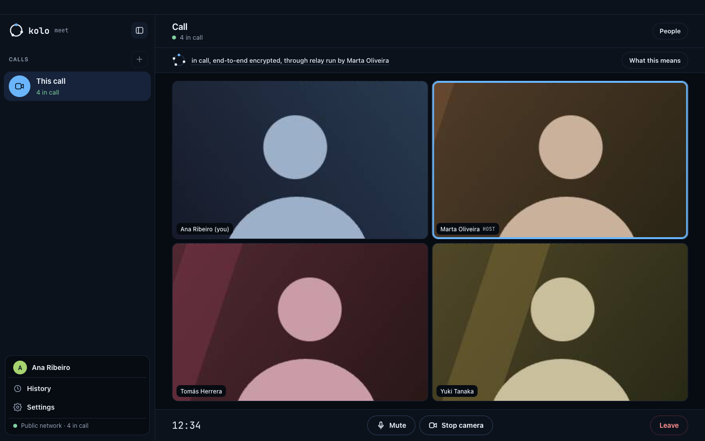

<p align="center"></p>

<h1 align="center">Kolo Meet</h1>

<p align="center"><b>An example video call program for Kolo, for 2 to 8 people: camera, microphone and the call, with no chat, no text messages and no files.</b></p>

<p align="center"><a href="https://github.com/ciranda-dev/kolo-meet-wails3-example/releases">Download</a> · <a href="docs/how-it-works.md">Docs</a> · <a href="CHANGELOG.md">Changelog</a></p>

<p align="center"><a href="CHANGELOG.md"></a> <a href="LICENSE"></a> <a href="go.mod"></a> <a href="go.mod"></a> <a href="#platforms"></a></p>



## What it does

- **Start a call** and copy an invite to send to the others, or **join with an invite** you were sent. Both are in the `+` beside Calls in the sidebar, and on the start screen.
- **Check your camera and microphone** in the lobby, then join.
- **See everyone** in a grid with names and who is speaking.
- **Mute, turn your camera off, or leave** from the window, the menu bar or tray, or on a Mac the notch window.
- **Remove someone** if you host: each person left changes their key once their copy sees it, so the removed person cannot open what is sent after that, and the invites you have no longer let them in. Someone who left needs a new invite too.
- **Find your way**: a sidebar holds the call that runs, your name, History, Settings and one line about the network (public, your own or this computer only, never an address). It folds to a narrow rail, and the window remembers that. The call fills the rest of the window, in the colors of Kolo, in a light or a dark theme.
- **Know what is protected**: the window says end-to-end encrypted only while every participant's keys have arrived, and what the relay still sees.
- **Call with no setup**: the example finds the others through the public Kolo network by default, so two people on different networks connect with no flag. `-bootstrap` uses a network of your own, and `-local` keeps everything on this computer.
- **Reach other networks** through connection relays you give with `-relay`, when two computers cannot connect directly.

## Platforms

| Platform | Install | Version | Status |
|---|---|---|---|
| macOS (universal) | `.dmg` or `.zip` | v0.1.0 | Beta, unsigned |
| Windows (amd64, arm64) | installer `.exe`, `.exe` or `.zip` | v0.1.0 | Beta, unsigned |
| Linux (amd64, arm64) | `.deb` or `.tar.gz` | v0.1.0 | Beta, unsigned |

Get the files from the [latest release](https://github.com/ciranda-dev/kolo-meet-wails3-example/releases), with `SHA256SUMS` to check them. They are not signed or notarized, so the system warns before the first run. Build your own with `scripts/release-local.sh` (see [build and test](docs/build-and-test.md)).

## Run it

You need Go 1.26 or later, Node.js with npm, and the Wails 3 CLI (`go install github.com/wailsapp/wails/v3/cmd/wails3@v3.0.0`). Every Kolo library comes from a published version in `go.mod`, so `GOWORK=off` builds work.

```sh
GOWORK=off wails3 build                 # build bin/kolo-meet
GOWORK=off go test ./...                # tests: made-up devices, 127.0.0.1 only
```

Live reload: `KOLO_MEET_DATA=/tmp/kolo-meet-demo/dev GOWORK=off wails3 dev`. (`GOWORK=off` matters only inside a Go workspace.)

The picture is sent in three sizes, 360p, 720p and 1080p, and moves up or down by itself with what the network carries. `-video-size` is the largest the camera is asked for (default 1920x1080) and `-video-bitrate` sets the VP8 bits a second. Less is sent as a call grows ([configuration](docs/configuration.md#audio-and-video)).

The window draws each person at 30 pictures a second in a call of up to 5 people and 15 with more, and falls back to 15 when drawing takes more than half a processor core; `-display-fps 30` or `15` fixes the rate ([display rate](docs/configuration.md#display-rate)). The example is in beta and the call quality report is on: while a call runs it writes numbers about it to `kolo-meet-quality.jsonl` in the data directory, so a test on a real network gives data. It holds counts, sizes and times, when each call was and how many people were in it, and no name, key, invite, address or media; the log says at start where it goes, and `-quality-report off` (or `KOLO_MEET_QUALITY=off`) turns it off, `-quality-log` also prints it ([what it holds](docs/security.md#the-call-quality-report), [how to read it](docs/how-it-works.md#reading-the-quality-report)). Calls use Reno; `-congestion bbr` is there to compare on a lossy path ([configuration](docs/configuration.md#congestion-control)).

## Try it

Each window needs its own data folder; the example creates it. The network is chosen with flags only; Settings shows it and has the command to copy. Details, permissions and a checklist are in [try it](docs/try-it.md).

| Network | How | What it is |
|---|---|---|
| Public, the default | no flag | the public entry nodes, run by Ciranda: free, with no uptime guarantee while Kolo is a beta. Two people on different networks find each other with no setup |
| Your own | `-bootstrap HOST:PORT[,HOST:PORT]` or `KOLO_BOOTSTRAP` | only your entry nodes are used, never the public ones |
| This computer only | `-local` or `KOLO_MEET_LOCAL=1` | the first window runs an entry node on 127.0.0.1 and the others join it |

`-local` cannot be used with `-bootstrap` or `-first`. If the public network cannot be reached when the example starts, the window says so and names the three options; it never switches network by itself.

### Anywhere, on the public network

Each person starts the example with no network flag.

```sh
./bin/kolo-meet -data /tmp/kolo-meet-demo/me
```

The host clicks Start a call and copies the invite; the guest clicks Join with an invite and pastes it.

### Same computer

Each window starts with `-local`. The first one runs the entry node on `127.0.0.1:7451` and the others join it; windows on other computers cannot reach it.

Terminal 1: the host.

```sh
./bin/kolo-meet -data /tmp/kolo-meet-demo/host -local
```

Terminal 2: the guest.

```sh
./bin/kolo-meet -data /tmp/kolo-meet-demo/guest -local
```

The host clicks Start a call and copies the invite; the guest clicks Join with an invite and pastes it.

### Two computers on your own network

Computer A runs an entry node and a connection relay with [kolo-node](https://github.com/ciranda-dev/kolo-node); allow UDP ports 7447 and 7448 in its firewall. Replace `<ip-of-computer-a>` with A's LAN IPv4 address and `<relay-key>` with the `key` the relay logs when it starts.

Computer A: install kolo-node.

```sh
go install github.com/ciranda-dev/kolo-node/cmd/kolo-node@v0.1.0
```

Computer A, terminal 1: the entry node (it creates its key file).

```sh
kolo-node run -listen 0.0.0.0:7447 -identity /tmp/kolo-meet-demo/node/node.key -first
```

Computer A, terminal 2: the relay (it creates its key file).

```sh
kolo-node relay -listen 0.0.0.0:7448 -identity /tmp/kolo-meet-demo/relay/relay.key
```

Computers A and B: the example.

```sh
./bin/kolo-meet -data /tmp/kolo-meet-demo/me \
  -bootstrap <ip-of-computer-a>:7447 \
  -relay <ip-of-computer-a>:7448@<relay-key>
```

The same lists also go in `KOLO_BOOTSTRAP` and `KOLO_MEET_RELAYS`.

### Your own network between different networks

The same commands, with one change: both copies must reach A, so `<ip-of-computer-a>` is a public IPv4 address, either A's own (for example a small server) or a router's with UDP ports 7447 and 7448 forwarded to A. The relay carries the call when the two computers cannot connect directly.

## Need a relay or a pin?

Kolo Meet needs entry nodes. It uses the public ones by default; run your own with `kolo-node run` and give them with `-bootstrap` ([Try it](#try-it)), or use `-local` for this computer only.

- **Call relay**: the host's example runs it for each call and every person's media goes through it. Nothing to install.
- **Connection relay**: optional, for two computers behind strict NATs that cannot connect directly. Run `kolo-node relay` on UDP port 7448 and give it to every copy with `-relay`, `-relay-file` or `KOLO_MEET_RELAYS`. It carries the connection to the call's relay and the key links, and cannot read them.
- **Pin**: not used. A call keeps nothing for later.

Entry nodes run with `kolo-node run` on UDP port 7447. The public servers are entry nodes only: there is no public relay and no public pin, and the example never uses one unless you give it. A relay is needed only behind strict NATs, and you run your own. Commands and ports: [your own servers](docs/own-servers.md).

### With the installed macOS app

The installed app reads `KOLO_MEET_RELAYS` from its environment, so start it from a terminal with your relay (replace the placeholders with your relay's address and its key, 64 hex characters):

```sh
KOLO_MEET_RELAYS="<relay-host>:7448@<relay-key>" /Applications/kolo-meet.app/Contents/MacOS/kolo-meet
```

On other systems, set the same variable in the environment of the process before it starts. The flag `-relay` and the file `-relay-file` work the same way and win over the variable.

## How it uses Kolo

| Kolo library | What the example uses it for |
|---|---|
| [kolo-media](https://github.com/ciranda-dev/kolo-media) | publishing and playing the audio and video, end-to-end encrypted with group keys once every key has arrived ([details](docs/security.md)) |
| [kolo-moq](https://github.com/ciranda-dev/kolo-moq) | the relay the host runs, which carries the media |
| [kolo-audio](https://github.com/ciranda-dev/kolo-audio) | microphones, speakers and the Opus codec |
| [kolo-video](https://github.com/ciranda-dev/kolo-video) | cameras and the VP8 codec |
| [kolo-invite](https://github.com/ciranda-dev/kolo-invite) | the invite and letting guests in |
| [kolo-swarm](https://github.com/ciranda-dev/kolo-swarm) | finding the host and the other participants, and trying the connection relays when a direct connection fails |
| [kolo-relay](https://github.com/ciranda-dev/kolo-relay) | the connection relays are kolo-relay servers; the example names their refusals (full, not allowed, wrong key) in the call and in Settings, and proves each relay's key whenever the network starts |
| [kolo-dht](https://github.com/ciranda-dev/kolo-dht) | the network nodes, the public entry nodes, and the entry node that `-local` and `-first` run |
| [kolo-secure](https://github.com/ciranda-dev/kolo-secure) | the encrypted connections |
| [kolo-transport](https://github.com/ciranda-dev/kolo-transport) | room for the many media streams on one connection |
| [kolo-store](https://github.com/ciranda-dev/kolo-store) | the invite's records, in memory |
| [kolo-id](https://github.com/ciranda-dev/kolo-id) | the example's identity and the relay's identity |

## Where the Kolo code is

- `guest.go`: kolo-swarm `Join` with `Lookup` finds the host on the invite's topic (the host announces it in `host.go`).
- `publisher.go`: kolo-media publishes your audio (Opus) and video (VP8) as tracks of the call's broadcast.
- `member.go`: kolo-moq connects to the call's relay, `kolomedia.Watch` subscribes to each person, and `updateMembers` rotates the group key (`Sender.SetMembers`) when someone joins, leaves or is removed.
- `hw.go`: kolo-video `OpenCapture` for the camera, kolo-audio `OpenInput` and `OpenOutput` for the microphone and the speaker.
- `config.go`: the connection relay list from `-relay` and `-relay-file` (kolo-swarm `ParseRelays`, `LoadRelays`), passed to `koloswarm.Config.Relays` in `meetservice.go`.

## Project layout

```text
main.go, config.go         start the example; flags, environment variables and defaults
meetservice.go             the methods the window calls
host.go, guest.go          starting a call and joining one
call.go, security.go       the call and its states; the security line the window shows
connrelay.go, errors.go    connection relays and their states; every error and its sentence
publisher.go, remote.go    sending your media and playing the others'
devices.go, hw.go          cameras, microphones and speakers
notch.go, tray.go          what the notch window and the tray show
report.go                  ReportError: a window's error in the terminal log
frontend/src/App.jsx       the main window (React); CallView.jsx is the grid, Notch.jsx the notch page
```

## Learn more

- [Try it](docs/try-it.md), [your own servers](docs/own-servers.md), [how a call works](docs/how-it-works.md), [configuration](docs/configuration.md), [notch and tray](docs/notch-and-tray.md)
- [Security and end-to-end encryption](docs/security.md), [build and test](docs/build-and-test.md)
- [Changelog](CHANGELOG.md), [security policy](SECURITY.md), [license](LICENSE) (Apache-2.0)
